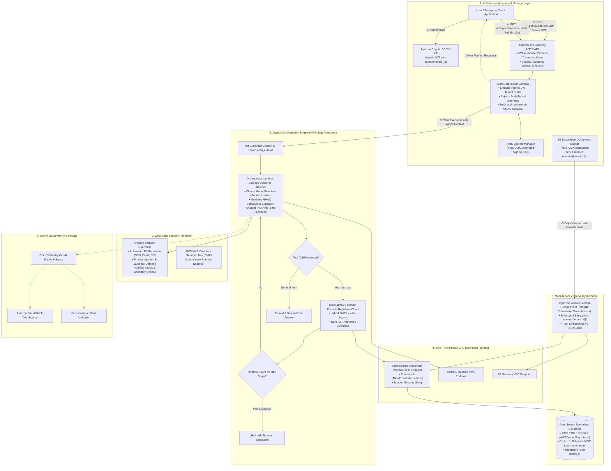

# Enterprise Agentic Reference Architecture on AWS
### Stateful Agent Orchestration, Multi-Tenant Hybrid Vector RAG & Bedrock Converse Tool Use

[](https://aws.amazon.com/bedrock/)
[](https://aws.amazon.com/opensearch-service/features/serverless/)
[](https://aws.amazon.com/step-functions/)
[](https://opentelemetry.io/)
[](https://www.terraform.io/)
[](LICENSE)

---

## Executive Summary

This repository provides a production-hardened reference architecture for deploying stateful, multi-tenant agentic workflows on Amazon Web Services (AWS). Utilizing the **Amazon Bedrock Converse API** (configured for the Anthropic Claude model family), this architecture demonstrates how enterprises can implement deterministic tool calling, cryptographically isolated multi-tenant hybrid retrieval-augmented generation (RAG), and zero-trust security boundaries without brittle in-memory loops or unmanaged vendor platforms.

This blueprint systematically addresses critical enterprise failure modes in generative AI adoption:
1. **Unbounded Agent Loops & Execution Timeouts**: Replaces fragile in-memory while-loops in container or Lambda runtimes with stateful, auditable **AWS Step Functions** orchestrators with deterministic iteration ceilings.
2. **Horizontal Privilege Escalation (IDOR) & Tenant Spoofing**: Enforces cryptographic tenant identity binding via **JWT-verified identity claims sealed with HMAC-SHA256 signatures** and strict S3 tenant prefix boundaries (`tenants/{tenant_id}/*`).
3. **Network Perimeter Exposure**: Enforces **strictly private network isolation** (`AllowFromPublic = false`) using dedicated **OpenSearch Serverless Interface VPC Endpoints** and private Lambda VPC subnets.
4. **Vector Mapping Drift**: Declaratively establishes explicit 1,024-dimensional HNSW k-NN vector schemas with automated Terraform index bootstrapping.
5. **Broad IAM Blast Radii**: Enforces strict separation of concerns across **three decoupled least-privilege IAM roles** with zero cross-plane permission leakage.
6. **Data Leakage & Runaway Token Spend**: Enforces perimeter safety via **Amazon Bedrock Guardrails** (automated PII redaction, prompt injection defense) and real-time FinOps cost attribution via **OpenTelemetry GenAI Semantic Conventions** and CloudWatch Embedded Metric Format (EMF).

---

## Architecture Overview



---

## Key Architectural Tenets

### 1. Cryptographic Tenant Identity Binding (Zero Trust)
In enterprise multi-tenant architectures, trusting a `tenant_id` supplied in request JSON or mutable S3 object metadata introduces an immediate horizontal privilege escalation (IDOR) vector. This blueprint enforces tenant identity at the cryptographic perimeter:
- **Query Path**: The caller authenticates via Cognito or an enterprise OIDC provider. Amazon API Gateway validates the JWT signature and audience. The **Auth Gatekeeper Lambda** extracts the verified `custom:tenant_id` claim from the token context and seals it into a `VerifiedTenantContext` using an **HMAC-SHA256 signature** backed by AWS Secrets Manager. Any attempt by a caller to supply a conflicting `tenant_id` in the request body is rejected with HTTP 403.
- **Workflow Verification**: Every step in the AWS Step Functions loop passes this sealed context. The orchestrator verifies the HMAC signature and timestamp before dispatching vector queries.
- **Ingestion Path**: The S3 bucket policy denies object uploads outside `s3://<bucket>/tenants/${aws:PrincipalTag/tenant_id}/*`. The ingestion worker deterministically extracts tenant ownership from the S3 key hierarchy (`tenants/<tenant_id>/<doc>`) and rejects mismatched user metadata.

### 2. Private Network Isolation (`AllowFromPublic = false`)
OpenSearch Serverless collections are frequently misconfigured with `AllowFromPublic = true`, relying solely on IAM data policies. This architecture enforces network-layer defense-in-depth:
- The OpenSearch network security policy sets `AllowFromPublic = false`.
- Ingress is restricted strictly to an **Interface VPC Endpoint** (`aws_opensearchserverless_vpc_endpoint`) hosted across private subnets.
- Orchestrator and Ingestion Lambdas are deployed in the private VPC with egress security groups scoped to private endpoints for Bedrock, Secrets Manager, and the S3 Gateway Endpoint.

### 3. Explicit 1,024-Dimensional HNSW Vector Indexing
Amazon Titan Text Embeddings v2 supports multiple dimensionalities (256, 512, 1024). This architecture standardizes on **1,024 dimensions with L2 normalization** for maximum retrieval accuracy.
- A declarative index mapping (`terraform/modules/opensearch_serverless/index_mapping.json`) defines the collection schema with `dynamic: strict`, `embedding` typed as `knn_vector` using `faiss/hnsw` with cosine similarity, and `tenant_id` typed as `keyword`.
- Terraform automatically executes an index bootstrapping invocation upon collection creation, guaranteeing that vector fields and analyzers are properly provisioned before ingestion or query traffic arrives.

### 4. Dedicated Customer Managed Key (KMS CMK) Encryption
To satisfy enterprise SOC2, HIPAA, and ISO 27001 requirements, 100% of persisted data is encrypted using a dedicated **Customer Managed Key (KMS CMK)** with annual rotation enabled:
- **OpenSearch Serverless**: Configured with `AWSOwnedKey = false` and bound directly to the KMS CMK ARN.
- **S3 Knowledge Bucket**: Enforces KMS server-side encryption with S3 Bucket Keys enabled.
- **AWS Secrets Manager**: Encrypts the HMAC tenant context signing secret with the KMS CMK.

### 5. Decomposed Least-Privilege IAM Roles
Rather than sharing a single broad execution role across services, the architecture enforces strict boundary separation across three specialized roles:
1. **Orchestrator Role (`orchestrator_exec`)**: Scoped to Bedrock Converse inference (Claude models) and Titan embeddings invoke, read-only search on OpenSearch Serverless (`aoss:ReadDocument`, `aoss:DescribeIndex`), and Secrets Manager HMAC secret read. **Has zero S3 bucket access.**
2. **Ingestion Role (`ingestion_exec`)**: Scoped to Titan embeddings invocation only (**cannot invoke generative models**), read-only access to `s3://<bucket>/tenants/*`, and write/index permissions on OpenSearch Serverless (`aoss:WriteDocument`, `aoss:CreateIndex`).
3. **Auth Gatekeeper Role (`auth_gatekeeper_exec`)**: Scoped strictly to managing Step Functions executions (`StartExecution`, `DescribeExecution`) and managing the HMAC signing secret container.

### 6. Universal Asynchronous Query Lifecycle & Zero-Leakage Polling
Unlike naive prototypes that accept requests and drop results into an unmonitored queue, this architecture implements an end-to-end verified asynchronous lifecycle:
- **`POST /v1/agent/executions`**: Validates JWT tenant claims, seals `VerifiedTenantContext`, initiates the Step Functions state machine, and immediately returns HTTP `202 ACCEPTED` with `execution_id`, `execution_arn`, and `poll_url`.
- **`GET /v1/agent/executions/{execution_id}`**: Enforces **pre-status tenant verification** across all states (`RUNNING`, `SUCCEEDED`, `FAILED`, `TIMED_OUT`, `ABORTED`). Before disclosing running status, start times, or error details, the handler parses the execution's sealed `auth_context` and verifies ownership against caller's JWT `custom:tenant_id`. Cross-tenant probes and missing tenant bindings are rejected immediately with HTTP 403 Forbidden.
- **Data Privacy (Zero CloudWatch Log Leakage)**: Step Functions logging is configured with `include_execution_data = false` and `level = "ERROR"`. Prompts, retrieved vector chunks, and model answers are never persisted to CloudWatch log streams.

### 7. Zero-Trust State Hygiene & Fail-Fast Dependency Layering
- **Zero Sensitive Data in Terraform State**: Plaintext HMAC signing keys are never declared via `random_password` or written to `.tfstate`. The Gatekeeper Lambda auto-seeds a cryptographically secure 256-bit key on first boot directly in AWS Secrets Manager under KMS CMK encryption (or operators seed/rotate it out-of-band via `scripts/seed_hmac_secret.sh`).
- **Fail-Fast Dependency Layering**: An automated Lambda Layer (`opensearch_dependencies`) compiles Linux x86_64 binary wheels for `opensearch-py 2.8.0`, `requests-aws4auth 1.3.1`, and OpenTelemetry SDK packages. The build script verifies package installation and fails fast with `exit 1` if dependencies are missing, preventing phantom layers from deploying.
- **Remote Backend Baseline**: Includes `terraform/backend.tf.example` configuring encrypted S3 state with DynamoDB locking.

### 8. Real-Time CloudWatch EMF, OpenTelemetry Spans & Multi-Tenant FinOps
Model invocations are instrumented with **authentic OpenTelemetry distributed tracing spans** (`gen_ai.client.turn`) and **CloudWatch Embedded Metric Format (EMF)**:
- Zero-latency metric publication to custom CloudWatch namespace `EnterpriseClaude/AgenticWorkflows`.
- Real-time attribution of `EstimatedCostUSD`, `InputTokens`, `OutputTokens`, and `TurnLatencyMs` dimensioned by `TenantId` and `ModelId`.
- CloudWatch Dashboard using dynamic `SEARCH()` metric expressions to discover and graph real-time dollar costs and token burn across all tenants without hardcoded filters.
- Exact binding between Step Functions execution metrics and the deployed state machine ARN.

---

## Repository Structure

```text
.
├── LICENSE
├── README.md
├── requirements.txt              # Runtime dependencies (opensearch-py, requests-aws4auth)
├── docs/
│   └── adr/
│       ├── 0001-bedrock-claude-vs-direct-api.md
│       ├── 0002-opensearch-serverless-vs-pgvector.md
│       ├── 0003-step-functions-vs-in-memory-loops.md
│       ├── 0004-cryptographic-tenant-isolation-and-iam-separation.md
│       └── 0005-dependency-layering-async-delivery-and-state-security.md
├── scripts/
│   ├── build_layer.sh            # Automated Lambda Layer packager for opensearch-py
│   └── seed_hmac_secret.sh       # Out-of-band CSPRNG HMAC secret seed and rotation
├── src/
│   ├── auth/
│   │   ├── __init__.py
│   │   └── handler.py            # API Gateway JWT gatekeeper & execution polling lifecycle
│   ├── shared/
│   │   ├── config.py             # Strongly typed application environment settings
│   │   ├── opensearch_index.py   # Explicit 1,024-dim HNSW k-NN index schema & bootstrapper
│   │   ├── telemetry.py          # OpenTelemetry GenAI spans & CloudWatch EMF FinOps metrics
│   │   └── tenant_context.py     # HMAC-SHA256 cryptographic tenant sealing & verification
│   ├── orchestrator/
│   │   ├── __init__.py
│   │   ├── handler.py            # Step Functions inference & tool execution loop worker
│   │   ├── claude_client.py      # Bedrock Converse client with Converse-level tool calling
│   │   └── tools/
│   │       ├── base.py           # Abstract BaseTool contract with JSON schema export
│   │       ├── calculator.py     # AST-parsed deterministic math calculator
│   │       └── rag_retriever.py  # OpenSearch Serverless vector + BM25 hybrid retriever
│   └── ingestion/
│   │   ├── __init__.py
│   │   ├── handler.py            # S3 event listener (Titan Embeddings v2 vector indexing)
│   │   └── chunker.py            # Markdown-aware structural text chunker
├── tests/
│   ├── test_security_and_isolation.py         # Unit tests for HMAC tenant isolation & schema
│   └── test_execution_lifecycle_and_telemetry.py # Unit tests for polling, IDOR defense & EMF metrics
└── terraform/
    ├── main.tf                   # Root deployment module wiring all subsystems & VPC endpoints
    ├── variables.tf              # Configurable project variables & model IDs
    ├── outputs.tf                # Exported ARNs, API Gateway endpoints, and dashboard identifiers
    ├── versions.tf               # Terraform core and AWS provider version constraints
    ├── terraform.tfvars.example  # Production-ready configuration baseline
    ├── backend.tf.example        # S3 remote state configuration with DynamoDB locking
    └── modules/
        ├── security_kms_iam/     # Customer Managed Key (CMK) and key policies
        ├── opensearch_serverless/# Serverless collection, private VPCE, CMK encryption & data policies
        ├── bedrock_agent/        # Bedrock Guardrail definitions (PII & prompt safety)
        ├── orchestrator_step_functions/ # ASL agent state machine & execution roles
        └── observability_adot/   # CloudWatch telemetry & FinOps dashboards
```

---

## Architecture Decision Records (ADRs)

| ADR | Title | Decision Summary |
| :--- | :--- | :--- |
| [ADR-0001](docs/adr/0001-bedrock-claude-vs-direct-api.md) | Bedrock Claude vs. Direct Anthropic API | Leverage Amazon Bedrock for native IAM authentication, VPC endpoints, FedRAMP/HIPAA compliance, and Guardrails integration. |
| [ADR-0002](docs/adr/0002-opensearch-serverless-vs-pgvector.md) | OpenSearch Serverless vs. Amazon Aurora pgvector | Selected OpenSearch Serverless for combined BM25 keyword matching and dense vector search without database maintenance overhead. |
| [ADR-0003](docs/adr/0003-step-functions-vs-in-memory-loops.md) | Step Functions vs. In-Memory Agent Loops | Externalize agent control flow to Step Functions to bypass Lambda 15-minute limits, avoid runaway token burn, and capture auditable state. |
| [ADR-0004](docs/adr/0004-cryptographic-tenant-isolation-and-iam-separation.md) | Cryptographic Tenant Isolation & IAM Separation | Bind tenant identity via JWT authorizers and HMAC-SHA256 signatures; enforce S3 key prefixes and decompose Lambda execution roles. |
| [ADR-0005](docs/adr/0005-dependency-layering-async-delivery-and-state-security.md) | Universal IDOR Isolation, Data Privacy & Layering | Fail-fast opensearch-py packaging; universal pre-status tenant IDOR checks; eliminate CloudWatch execution data leakage. |

---

## Deployment & Getting Started

### Prerequisites
- [Terraform >= 1.5.0](https://www.terraform.io/downloads.html)
- [AWS CLI v2](https://docs.aws.amazon.com/cli/latest/userguide/install-cliv2.html) configured with Administrator permissions
- **Amazon Bedrock Model Access**: The defaults use the US cross-Region inference profiles `us.anthropic.claude-sonnet-5` (primary) and `us.anthropic.claude-haiku-5-5` (fallback), plus `amazon.titan-embed-text-v2:0`. Anthropic models need a one-time use-case submission in the Bedrock console before first use. Confirm the profiles exist in your Region with `aws bedrock list-inference-profiles`. Terraform grants IAM on both the profile ARN and the underlying foundation model in every Region the profile routes to.
- **Cost attribution (optional)**: Set `model_pricing_usd_per_1k_tokens` in `terraform.tfvars` from the [Bedrock pricing page](https://aws.amazon.com/bedrock/pricing/). Models without configured rates report `EstimatedCostUSD = 0`.

### 1. Clone & Configure
```bash
git clone git@github.com:mtskillman/enterprise-claude-agentic-aws-refarch.git
cd enterprise-claude-agentic-aws-refarch/terraform

cp terraform.tfvars.example terraform.tfvars
```

### 2. Plan and Deploy
```bash
terraform init
terraform plan -out=tfplan
terraform apply tfplan
```
*Terraform packages the `opensearch-py` Lambda Layer, provisions the VPC, OpenSearch Serverless collection, KMS CMK, Bedrock Guardrails, and Step Functions state machine, and automatically triggers the index bootstrapper to initialize the 1,024-dim vector mapping.*

### 3. Ingest Enterprise Documents Under Tenant Prefix
The bucket policy lets a principal tagged with `tenant_id` write only under its own `tenants/<tenant_id>/` prefix. Untagged principals can upload only if they are listed in `document_admin_principal_arns`. Before uploading, add your deployment or admin role ARN (the role ARN, not an `sts` session ARN) to that variable in `terraform.tfvars` and re-apply.

Upload documents into the tenant-specific S3 key prefix:
```bash
DOCS_BUCKET=$(terraform output -raw knowledge_bucket_name)

# Ingest an engineering policy under tenant 'engineering-dept'
aws s3 cp sample-failover-policy.md s3://${DOCS_BUCKET}/tenants/engineering-dept/policies/failover.md
```
The Ingestion Lambda validates the `tenants/engineering-dept/` prefix, extracts passages, generates 1,024-dim Titan v2 embeddings, and indexes chunks tagged with `tenant_id: "engineering-dept"`.

### 4. End-to-End Query & Result Polling Lifecycle

#### Step 4a: Provision a Tenant User
Self sign-up is disabled and app clients cannot write `custom:tenant_id`, so tenant membership is assigned only by an administrator:
```bash
USER_POOL_ID=$(terraform output -raw cognito_user_pool_id)

aws cognito-idp admin-create-user \
  --user-pool-id "${USER_POOL_ID}" \
  --username alice@example.com \
  --user-attributes Name=email,Value=alice@example.com Name=custom:tenant_id,Value=engineering-dept
```
Sign the user in with SRP (for example, with the Amplify Auth library) and use the **ID token** as the bearer token. Cognito access tokens do not carry custom attributes, so the `custom:tenant_id` claim is present only in the ID token.

#### Step 4b: Start Asynchronous Agent Execution
Call the authenticated HTTP API with the Cognito ID token:
```bash
API_ENDPOINT=$(terraform output -raw api_gateway_endpoint)
BEARER_TOKEN="<COGNITO_ID_TOKEN>"

START_RESP=$(curl -s -X POST "${API_ENDPOINT}" \
  -H "Authorization: Bearer ${BEARER_TOKEN}" \
  -H "Content-Type: application/json" \
  -d '{
    "prompt": "What is our company policy on multi-region failover, and what would be the total annual cost if our monthly bill is $14,500?"
  }')

echo "${START_RESP}"
# Output:
# {"status": "ACCEPTED", "execution_arn": "...", "execution_id": "c888e21a-...", "tenant_id": "engineering-dept", "poll_url": "/v1/agent/executions/c888e21a-..."}

EXECUTION_ID=$(echo "${START_RESP}" | jq -r '.execution_id')
```

#### Step 4c: Poll for Completion and Retrieve Answer
Poll the execution endpoint with the authenticated Bearer token:
```bash
POLL_ENDPOINT=$(terraform output -raw api_gateway_poll_endpoint | sed "s/{execution_id}/${EXECUTION_ID}/")

curl -s -X GET "${POLL_ENDPOINT}" \
  -H "Authorization: Bearer ${BEARER_TOKEN}" | jq .
```
When complete, the API returns the verified assistant response, reasoning iterations, and OpenTelemetry FinOps telemetry:
```json
{
  "status": "SUCCEEDED",
  "execution_id": "c888e21a-...",
  "tenant_id": "engineering-dept",
  "final_response": "According to the Engineering Multi-Region Failover Policy (DOC-482), secondary regions must achieve RTO < 15 minutes. For an ongoing monthly cloud spend of $14,500, the projected annual baseline cost is $174,000.00.",
  "iterations": 2,
  "telemetry": {
    "gen_ai.system": "aws.bedrock",
    "gen_ai.request.model": "us.anthropic.claude-sonnet-5",
    "gen_ai.usage.estimated_cost_usd": 0.0078,
    "gen_ai.usage.total_tokens": 1420
  }
}
```

---

## Running Unit Tests

Run the security, schema validation, and execution lifecycle suite locally:
```bash
python3 -m unittest discover tests
```

---

## Author & Attribution

**Matthew Skillman**  
*Anthropic Claude Certified Architect Professional | AWS Enterprise Solutions Architect*  
- **GitHub**: [@mtskillman](https://github.com/mtskillman)  
- **LinkedIn**: [linkedin.com/in/matthew-skillman](https://linkedin.com/in/matthew-skillman)  
- **Articles & Insights**: [caylent.com/insights](https://caylent.com/insights?author=57d88ca842a84e63b0ee95e1d9156d5a)

---

## License

This project is licensed under the MIT License — see the [LICENSE](LICENSE) file for details.
