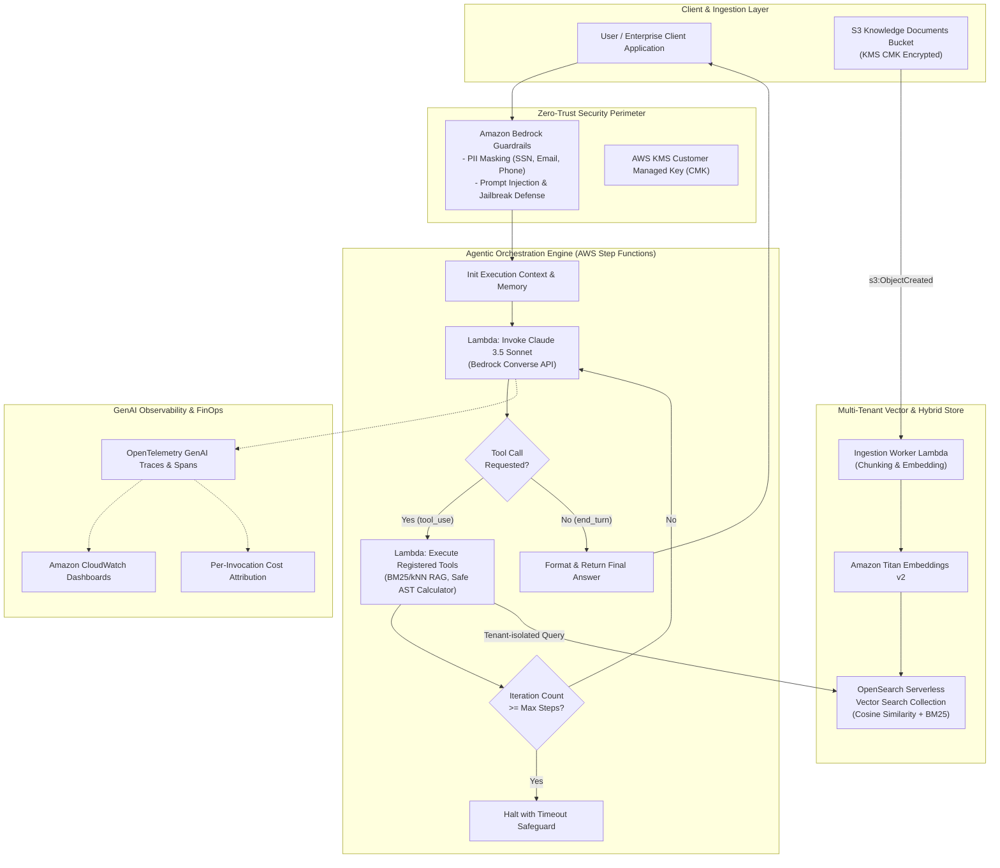

# Enterprise Agentic GenAI Reference Architecture on AWS
### Powered by Anthropic Claude 3.5 Sonnet, Amazon Bedrock, OpenSearch Serverless & AWS Step Functions

[](https://aws.amazon.com/bedrock/)
[](https://www.anthropic.com/claude)
[](https://aws.amazon.com/opensearch-service/features/serverless/)
[](https://aws.amazon.com/step-functions/)
[](https://opentelemetry.io/)
[](https://www.terraform.io/)
[](LICENSE)

---

## Executive Summary

This repository presents an **enterprise-grade, production-hardened reference architecture** for deploying autonomous agentic workflows on AWS. Utilizing **Anthropic Claude 3.5 Sonnet** via the **Amazon Bedrock Converse API**, this architecture demonstrates how mission-critical enterprises can implement complex tool use, multi-step deterministic reasoning, multi-tenant hybrid retrieval-augmented generation (RAG), and zero-trust security without vendor lock-in or fragile in-memory agent loops.

Designed by an Anthropic Claude Certified Architect with over six years of leading AWS enterprise cloud migrations, this blueprint directly solves common enterprise GenAI failure modes:
1. **Unbounded Agent Loops & Timeouts**: Replacing brittle in-memory while-loops in containerized or Lambda runtimes with stateful, audit-ready **AWS Step Functions** orchestrators.
2. **Hallucination & Document Retrieval Drift**: Employing **OpenSearch Serverless** with hybrid vector ($k$-NN) and lexical (BM25) search filtered by tenant metadata boundaries.
3. **Runaway Cloud & Token Costs**: Implementing automated model degradation fallbacks (Claude 3.5 Sonnet $\to$ Claude 3.5 Haiku) with real-time **OpenTelemetry GenAI Semantic Convention** token cost tracking.
4. **Data Leakage & Prompt Injection**: Enforcing dual-layer perimeter defense via **Amazon Bedrock Guardrails** for PII redaction and contextual prompt-attack blocking.

---

## Architecture Overview



---

## Key Architectural Tenets

### 1. Deterministic Orchestration via AWS Step Functions
Traditional Python agent frameworks (`LangChain`, `CrewAI`, `AutoGPT`) execute reasoning loops inside volatile runtime processes. In serverless environments, this creates severe architectural liabilities:
- Lambda's 15-minute hard execution timeout can terminate long-running tool executions prematurely.
- Process crashes discard full conversation state, requiring costly model re-invocations.
- Lack of observability into intermediate reasoning chains.

This reference architecture implements an **ASL (Amazon States Language)** state machine that externalizes loop control. Each step transition persists state into AWS Step Functions execution history, enforcing step quotas (e.g., maximum 10 reasoning cycles) and guaranteeing deterministic state recovery.

### 2. Hybrid Retrieval with OpenSearch Serverless
Pure dense vector semantic search frequently fails on exact enterprise identifiers (e.g., part numbers, SKU codes, policy IDs). Our retrieval tool executes **Hybrid Search** against OpenSearch Serverless:
- **Lexical BM25 Search**: Matches exact keywords, entity identifiers, and technical terminology.
- **k-NN Vector Search**: Powered by Amazon Titan Embeddings v2 (1,536 dimensions) for semantic intent and conceptual relevance.
- **Tenant Isolation**: Mandatory metadata filtering (`tenant_id = :tenant`) prevents cross-organization information disclosure.

### 3. Dual-Model Fallback & Resilience
Under high demand, upstream service throttling (HTTP 429) can disrupt production systems. The Bedrock Claude client provides automated model failover:
- **Primary Tier**: Anthropic Claude 3.5 Sonnet (`anthropic.claude-3-5-sonnet-20241022-v2:0`) for superior multi-step logic, structured output synthesis, and complex tool calling.
- **Fallback Tier**: Anthropic Claude 3.5 Haiku (`anthropic.claude-3-5-haiku-20241022-v1:0`) for rapid query routing and graceful service degradation under Sonnet rate-limiting.

### 4. Enterprise Guardrails & Content Moderation
Before prompts reach Claude and before responses return to users, **Amazon Bedrock Guardrails** inspects the payload:
- **Prompt Attack Mitigation**: High-sensitivity blocking of jailbreaks and prompt override vectors.
- **PII Redaction**: Automatic masking of Social Security numbers, credit card numbers, phone numbers, and email addresses.
- **Enterprise Topic Boundaries**: Rejection of off-topic enterprise inquiries.

### 5. FinOps & OpenTelemetry GenAI Semantic Conventions
Every LLM call emits structured telemetry conforming to [OpenTelemetry GenAI Conventions](https://opentelemetry.io/docs/specs/semconv/gen-ai/):
- `gen_ai.system`: `bedrock`
- `gen_ai.request.model`: Model identifier
- `gen_ai.usage.input_tokens` and `gen_ai.usage.output_tokens`
- **Cost Calculation**: Real-time dollar cost attribution calculated per invocation and surfaced directly on CloudWatch dashboards.

---

## Repository Structure

```text
.
├── LICENSE
├── README.md
├── docs/
│   └── adr/
│       ├── 0001-bedrock-claude-vs-direct-api.md
│       ├── 0002-opensearch-serverless-vs-pgvector.md
│       └── 0003-step-functions-vs-in-memory-loops.md
├── src/
│   ├── shared/
│   │   ├── config.py             # Strongly typed pydantic environment settings
│   │   └── telemetry.py          # OpenTelemetry GenAI spans & FinOps cost calculation
│   ├── orchestrator/
│   │   ├── claude_client.py      # Bedrock Converse API client with Sonnet -> Haiku fallback
│   │   ├── handler.py            # Dual-mode Lambda handler (INFERENCE / TOOL_EXECUTION)
│   │   └── tools/
│   │       ├── base.py           # Abstract BaseTool with JSON schema generation
│   │       ├── rag_retriever.py  # OpenSearch Serverless hybrid BM25 + kNN retrieval
│   │       └── calculator.py     # Deterministic Python AST safe arithmetic evaluator
│   └── ingestion/
│       ├── chunker.py            # Sliding-window document chunking with overlap
│       └── handler.py            # S3 upload event worker indexing vectors to OpenSearch
└── terraform/
    ├── main.tf                   # Root deployment module wiring all subsystems
    ├── variables.tf              # Configurable project variables & model IDs
    ├── outputs.tf                # Exported ARNs, endpoints, and dashboard identifiers
    ├── versions.tf               # Terraform core and AWS provider version constraints
    ├── terraform.tfvars.example  # Production-ready configuration baseline
    └── modules/
        ├── security_kms_iam/     # Customer Managed Key (CMK) and key policies
        ├── opensearch_serverless/# Serverless collection, encryption, network & data policies
        ├── bedrock_agent/        # Bedrock Guardrail definitions (PII & prompt safety)
        ├── orchestrator_step_functions/ # ASL agent state machine & execution roles
        └── observability_adot/   # CloudWatch telemetry & FinOps dashboards
```

---

## Architecture Decision Records (ADRs)

Key architectural choices are formally documented in accordance with enterprise software engineering standards:

| ADR | Title | Decision Summary |
| :--- | :--- | :--- |
| [ADR-0001](docs/adr/0001-bedrock-claude-vs-direct-api.md) | Bedrock Claude vs. Direct Anthropic API | Leverage Amazon Bedrock for native IAM authentication, VPC endpoints, FedRAMP/HIPAA compliance, and Guardrails integration. |
| [ADR-0002](docs/adr/0002-opensearch-serverless-vs-pgvector.md) | OpenSearch Serverless vs. Amazon Aurora pgvector | Selected OpenSearch Serverless for combined BM25 keyword matching and dense vector search without database maintenance overhead. |
| [ADR-0003](docs/adr/0003-step-functions-vs-in-memory-loops.md) | Step Functions vs. In-Memory Agent Loops | Externalize agent control flow to Step Functions to bypass Lambda 15-minute limits, avoid runaway token burn, and capture auditable state. |

---

## Deployment & Getting Started

### Prerequisites
- [Terraform >= 1.5.0](https://www.terraform.io/downloads.html)
- [AWS CLI v2](https://docs.aws.amazon.com/cli/latest/userguide/install-cliv2.html) configured with Administrator permissions
- **Amazon Bedrock Model Access**: Ensure `anthropic.claude-3-5-sonnet-20241022-v2:0` and `amazon.titan-embed-text-v2:0` are enabled in your target AWS region (`us-east-1` or `us-west-2`).

### 1. Clone & Configure
```bash
git clone git@github.com:mtskillman/enterprise-claude-agentic-aws-refarch.git
cd enterprise-claude-agentic-aws-refarch/terraform

cp terraform.tfvars.example terraform.tfvars
```

Edit `terraform.tfvars` to customize your environment:
```hcl
aws_region   = "us-east-1"
environment  = "prod"
project_name = "claude-agentic-platform"
```

### 2. Plan and Deploy
```bash
terraform init
terraform plan -out=tfplan
terraform apply tfplan
```

### 3. Ingest Enterprise Documents
Upload markdown or text files to the provisioned document bucket:
```bash
DOCS_BUCKET=$(terraform output -raw knowledge_bucket_name)

aws s3 cp sample-enterprise-policy.txt s3://${DOCS_BUCKET}/engineering-standards.txt
```
The Ingestion Lambda automatically processes the upload, generates Titan v2 embeddings, and indexes chunks into the OpenSearch Serverless collection.

### 4. Trigger the Agentic State Machine
Execute the Step Functions state machine with a user query:
```bash
STATE_MACHINE_ARN=$(terraform output -raw step_functions_state_machine_arn)

aws stepfunctions start-execution \
  --state-machine-arn "${STATE_MACHINE_ARN}" \
  --input '{
    "messages": [
      {
        "role": "user",
        "content": [{"text": "What is our company policy on multi-region failover, and what would be the total annual cost if our monthly bill is $14,500?"}]
      }
    ],
    "tenant_id": "engineering-dept",
    "iteration_count": 0,
    "max_iterations": 8
  }'
```

---

## Security & Compliance Architecture

- **Encryption at Rest**: 100% of persisted data (S3 documents, OpenSearch indices, CloudWatch log streams) is encrypted using a dedicated **Customer Managed Key (KMS CMK)** with automatic annual key rotation.
- **Encryption in Transit**: All Bedrock API calls, OpenSearch REST invocations, and Lambda triggers enforce TLS 1.3.
- **Zero-Trust IAM**: Lambda functions execute under scoped IAM roles granting least-privilege access restricted strictly to specific resource ARNs (no `Resource: "*"` wildcard policies on sensitive data paths).
- **Network Isolation**: OpenSearch Serverless collections are governed by strict data access policies, ensuring only the orchestrator and ingestion Lambdas possess indexing and search capabilities.

---

## Cost Optimization (FinOps)

This architecture is **100% serverless and usage-driven**:
- **Zero Idle Capacity**: No provisioned EC2 instances, OpenSearch warm clusters, or fixed RDS instances.
- **OpenSearch Serverless**: Automatically scales OCUs (OpenSearch Compute Units) from 0 to peak during indexing and queries.
- **Claude Model Switching**: Routine routing or fallback workloads can dynamically leverage Haiku 3.5 at an ~80% token cost reduction compared to Sonnet.

---

## Author & Attribution

**Matthew Skillman**  
*Anthropic Claude Certified Architect Professional | AWS Enterprise Solutions Architect*  
- **GitHub**: [@mtskillman](https://github.com/mtskillman)  
- **LinkedIn**: [linkedin.com/in/matthew-skillman](https://linkedin.com/in/matthew-skillman)  
- **Articles & Insights**: [caylent.com/insights](https://caylent.com/insights?author=57d88ca842a84e63b0ee95e1d9156d5a)

---

## License

This project is licensed under the MIT License — see the [LICENSE](LICENSE) file for details.
